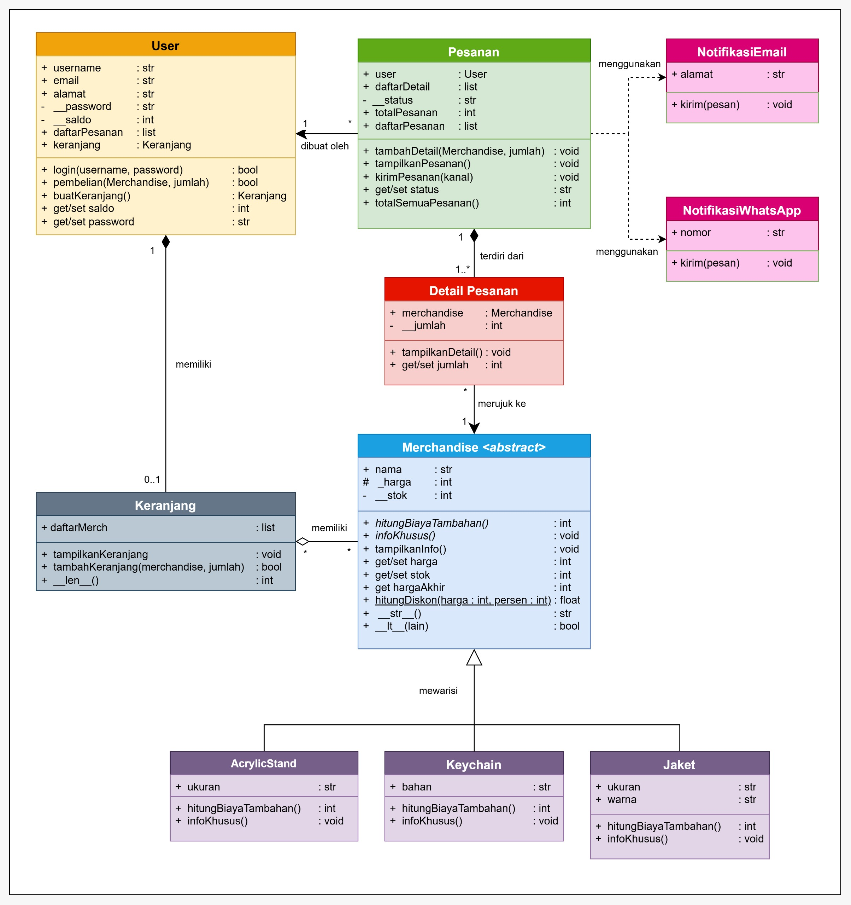
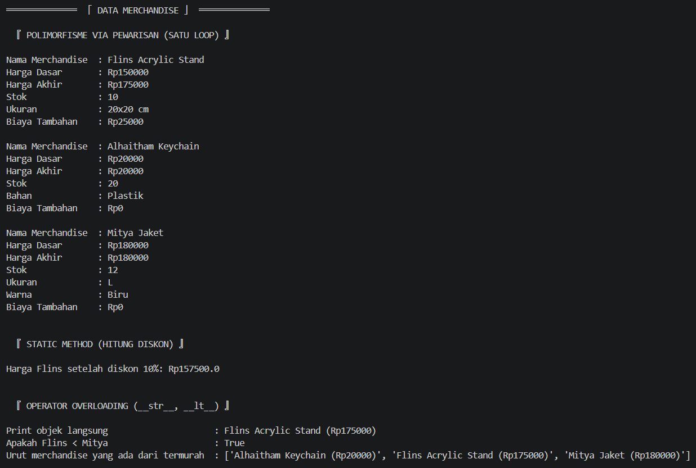
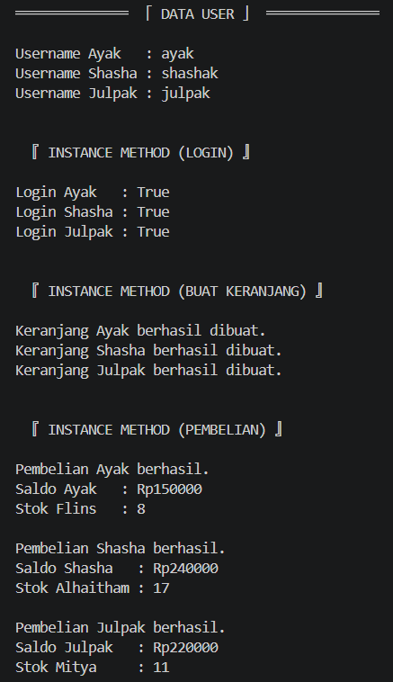
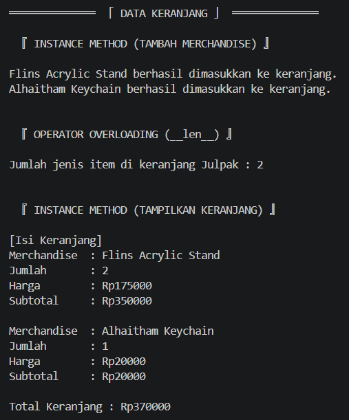
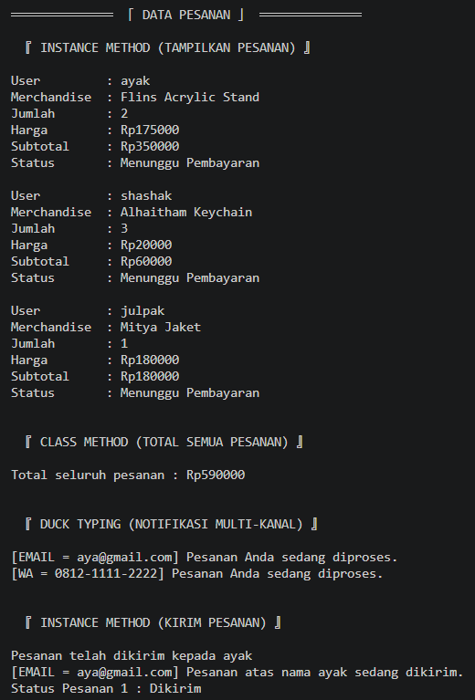
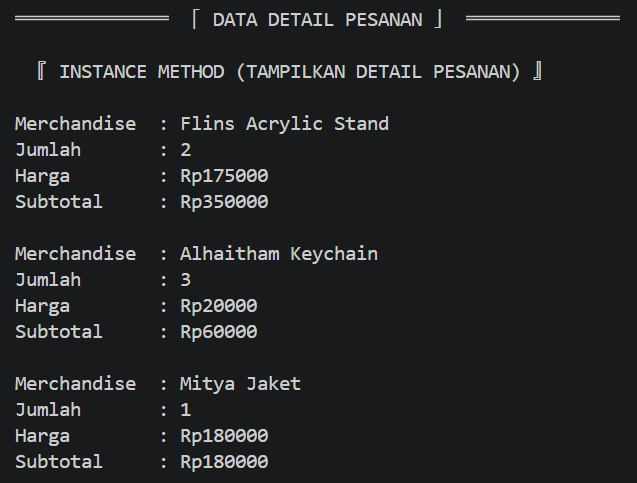
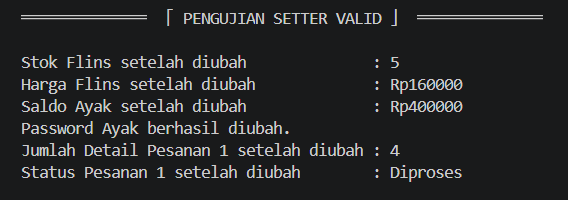
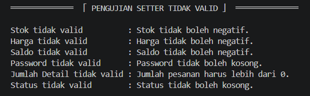
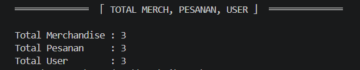
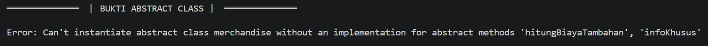

# Posttest 3 - "Sistem Penjualan dan Pemesanan Merchandise Genshin Impact pada Platform Toko Online"

════════════════════════════════════════════════════════════════════════════════════════════

## Deskripsi Program

Program ini mensimulasikan sistem penjualan dan pemesanan merchandise
Genshin Impact lewat online.

Program menerapkan konsep OOP, seperti class, object, attribute, method,
encapsulation, property, inheritance, static method, class method, abstraksi
(abstract base class), polimorfisme (override method, duck typing, dan operator
overloading), serta hubungan antar class (UML). Terdapat class abstrak untuk
menyimpan data merchandise, jaket dan acrylic stand dan keychain sebagai turunan merchandise, kanal notifikasi (email dan WhatsApp), detail pesanan, keranjang,
pesanan, dan pengguna.

Program dapat melakukan beberapa proses, yaitu:

1.  Menambahkan dan menampilkan data merchandise.
2.  Menghitung diskon merchandise.
3.  Menggunakan inheritance melalui subclass `acrylicStand`, `keychain`, dan `jaket`.
4.  Membuat dan menampilkan data user.
5.  Melakukan login user.
6.  Membuat keranjang milik user.
7.  Melakukan pembelian merchandise.
8.  Mengurangi saldo user setelah pembelian.
9.  Mengurangi stok merchandise setelah pembelian.
10. Menambahkan merchandise ke keranjang dan menampilkan isi keranjang.
11. Membuat pesanan dan menambahkan detail pesanan.
12. Menampilkan data pesanan.
13. Mengirim pesanan beserta notifikasinya.
14. Menampilkan detail pesanan.
15. Menghitung total harga seluruh pesanan.
16. Mengubah status pesanan.
17. Menguji getter dan setter dengan data valid maupun tidak valid.
18. Menghitung jumlah seluruh objek merchandise, pesanan, dan user.
19. Membuktikan bahwa class abstrak `merchandise` tidak dapat diinstansiasi.
20. Memanggil method yang sama pada objek subclass berbeda lewat satu loop (polimorfisme via pewarisan).
21. Mengirim notifikasi lewat kanal berbeda memakai satu fungsi yang sama (duck typing).
22. Membandingkan dan mengurutkan merchandise serta menghitung isi keranjang (operator overloading).


════════════════════════════════════════════════════════════════════════════════════════════


## Struktur Class
Program ini memiliki sepuluh class dan satu fungsi pendukung, yaitu:


### 1. Class `merchandise`
Berfungsi sebagai class dasar sekaligus abstract class (menggunakan `ABC`) untuk menyimpan data umum merchandise yang ada. Class ini tidak bisa dibuat objeknya secara langsung dan wajib diturunkan.

#### a. Class Attribute
- `totalMerchandise` = Menyimpan jumlah seluruh objek merchandise yang dibuat, termasuk objek dari subclass.

#### b. Instance Attribute
- `nama` = Menyimpan nama merchandise.
- `_harga` = Menyimpan harga merchandise.
- `__stok` = Menyimpan jumlah stok merchandise secara privat (agar tidak bisa diubah sembarangan).

#### c. Method
- `__init__()` = Membuat objek merchandise mengisi data awal otomatis serta menambah `totalMerchandise`.
- `hitungBiayaTambahan()` = Abstract method, untuk menghitung biaya tambahan sesuai jenis merchandise. Wajib diimplementasikan oleh setiap subclass.
- `infoKhusus()` = Abstract method, untuk menampilkan informasi unik tiap jenis merchandise. Wajib diimplementasikan oleh setiap subclass.
- `tampilkanInfo()` = Method konkret yang dipakai bersama oleh semua subclass tanpa di-override, untuk menampilkan informasi umum merchandise lalu memanggil `infoKhusus()`.
- `property hargaAkhir` = Method konkret (getter), untuk mengambil harga akhir, yaitu `_harga` ditambah hasil `hitungBiayaTambahan()`.
- `hitungDiskon()` = Static method, untuk menghitung harga setelah diskon.
- `property harga` = Getter, untuk mengambil nilai harga (karena harga di-privat).
- `harga.setter` = Setter, untuk mengubah harga dengan ketentuan tidak boleh negatif.
- `property stok` = Getter, untuk mengambil nilai stok (karena stok di-privat).
- `stok.setter` = Setter, untuk mengubah stok dengan ketentuan tidak boleh negatif.
- `__str__()` = Operator overloading, agar objek dapat di-print langsung (menampilkan nama dan harga akhir).
- `__lt__()` = Operator overloading untuk operator `<`, membandingkan harga akhir sehingga merchandise dapat diurutkan dengan `sorted()`.

___________________________________________

### 2. Class `acrylicStand`
Merupakan subclass dari `merchandise` yang digunakan untuk merchandise
jenis acrylic stand.

#### a. Instance Attribute
- `ukuran` = Menyimpan ukuran acrylic stand.

#### b. Method
- `__init__()` = Memanggil constructor class `merchandise` menggunakan `super()`, kemudian mengisi ukuran.
- `hitungBiayaTambahan()` = Implementasi abstract method. Jika ukuran `"20x20 cm"`, biaya tambahan Rp25.000, selain itu Rp0.
- `infoKhusus()` = Implementasi abstract method, menampilkan informasi ukuran acrylic stand.

___________________________________________

### 3. Class `keychain`
Merupakan subclass dari `merchandise` yang digunakan untuk merchandise
jenis keychain.

#### a. Instance Attribute
- `bahan` = Menyimpan bahan keychain.

#### b. Method
- `__init__()` = Memanggil constructor class `merchandise` menggunakan `super()`, kemudian mengisi bahan.
- `hitungBiayaTambahan()` = Implementasi abstract method. Jika bahan `"Boneka"`, biaya tambahan Rp20.000, selain itu Rp0.
- `infoKhusus()` = Implementasi abstract method, menampilkan informasi bahan keychain.

___________________________________________

### 4. Class `jaket`
Merupakan subclass dari `merchandise` yang digunakan untuk merchandise jenis jaket.

#### a. Instance Attribute
- `ukuran` = Menyimpan ukuran jaket.
- `warna` = Menyimpan warna jaket.

#### b. Method
- `__init__()` = Memanggil constructor class `merchandise` menggunakan `super()`, kemudian mengisi ukuran dan warna.
- `hitungBiayaTambahan()` = Implementasi abstract method. Jaket tidak memiliki biaya tambahan, sehingga mengembalikan Rp0.
- `infoKhusus()` = Implementasi abstract method, menampilkan informasi ukuran serta warna jaket.

___________________________________________

### 5. Class `notifikasiEmail`
Berfungsi sebagai kanal notifikasi lewat email. Class ini tidak berhubungan lewat pewarisan dengan class lain (duck typing).

#### a. Instance Attribute
- `alamat` = Menyimpan alamat email tujuan notifikasi.

#### b. Method
- `__init__()` = Membuat objek notifikasi email dan mengisi alamat.
- `kirim()` = Menampilkan pesan notifikasi yang dikirim ke alamat email.

___________________________________________

### 6. Class `notifikasiWhatsApp`
Berfungsi sebagai kanal notifikasi lewat WhatsApp. Class ini juga tidak berhubungan lewat pewarisan dengan class lain (duck typing), tetapi memiliki method `kirim()` yang namanya sama dengan `notifikasiEmail`.

#### a. Instance Attribute
- `nomor` = Menyimpan nomor WhatsApp tujuan notifikasi.

#### b. Method
- `__init__()` = Membuat objek notifikasi WhatsApp dan mengisi nomor.
- `kirim()` = Menampilkan pesan notifikasi yang dikirim ke nomor WhatsApp.

#### c. Fungsi Pendukung
- `beritahuUser()` = Fungsi biasa (di luar class) yang menerima daftar kanal dan pesan, lalu memanggil `kirim()` pada setiap kanal tanpa perlu mengetahui jenis kanalnya.

___________________________________________

### 7. Class `detailPesanan`
Berfungsi untuk menyimpan detail merchandise yang terdapat dalam suatu pesanan.

#### a. Instance Attribute
- `merchandise` = Menyimpan objek merchandise yang dipesan.
- `__jumlah` = Menyimpan jumlah merchandise yang dipesan secara privat (agar tidak bisa diubah sembarangan).

#### b. Method
- `__init__()` = Membuat objek detail pesanan dan mengisi data awal otomatis.
- `tampilkanDetail()` = Menampilkan informasi detail pesanan (harga dan subtotal dihitung dari `hargaAkhir`).
- `property jumlah` = Getter, untuk mengambil jumlah merchandise (karena jumlah di-privat).
- `jumlah.setter` = Setter, untuk mengubah jumlah dengan ketentuan harus lebih dari nol.

___________________________________________

### 8. Class `keranjang`
Berfungsi untuk menyimpan daftar merchandise yang dimasukkan ke dalam keranjang.

#### a. Instance Attribute
- `daftarMerch` = Menyimpan daftar merchandise dan jumlahnya di dalam keranjang.

#### b. Method
- `__init__()` = Membuat objek keranjang dan menyiapkan daftar merchandise kosong.
- `tampilkanKeranjang()` = Menampilkan informasi keranjang.
- `tambahKeranjang()` = Menambahkan merchandise ke keranjang dengan ketentuan jumlah harus lebih dari nol dan stok mencukupi.
- `__len__()` = Operator overloading, agar `len(keranjang)` menghasilkan jumlah jenis merchandise di dalam keranjang.

___________________________________________

### 9. Class `pesanan`
Berfungsi untuk menyimpan data pesanan yang dilakukan oleh user serta detail merchandise yang dipesan.

#### a. Class Attribute
- `statusPesanan` = Menyimpan status default awal pesanan.
- `totalPesanan` = Menyimpan jumlah seluruh objek pesanan yang dibuat.
- `daftarPesanan` = Menyimpan seluruh objek pesanan yang telah dibuat.

#### b. Instance Attribute
- `user` = Menyimpan user yang melakukan pesanan.
- `daftarDetail` = Menyimpan daftar objek `detailPesanan` yang terdapat dalam pesanan.
- `__status` = Menyimpan status pesanan secara privat (agar tidak bisa diubah sembarangan).

#### c. Method
- `__init__()` = Membuat objek pesanan dan mengisi data awal, menambah jumlah pesanan, memasukkan pesanan ke `daftarPesanan`, dan memasukkan pesanan ke daftar pesanan milik user.
- `tambahDetail()` = Membuat objek `detailPesanan` dan memasukkannya ke `daftarDetail`.
- `tampilkanPesanan()` = Menampilkan informasi objek pesanan.
- `kirimPesanan()` = Mengubah status pesanan menjadi "Dikirim", lalu mengirim notifikasi lewat objek kanal yang diterima dari luar sebagai parameter `kanal`.
- `property status` = Getter, untuk mengambil status pesanan (karena status di-privat).
- `status.setter` = Setter, untuk mengubah status dengan ketentuan tidak boleh kosong.
- `totalSemuaPesanan()` = Class method, untuk menghitung total harga dari seluruh detail pada seluruh pesanan.

___________________________________________

### 10. Class `user`
Berfungsi untuk menyimpan data pengguna dan melakukan proses yang berkaitan dengan pembelian.

#### a. Class Attribute
- `totalUser` = Menyimpan jumlah seluruh objek user yang dibuat.
- `statusUser` = Menyimpan status default user.

#### b. Instance Attribute
- `username` = Menyimpan username user.
- `email` = Menyimpan email user.
- `alamat` = Menyimpan alamat user.
- `__password` = Menyimpan password user secara privat (agar tidak bisa diubah sembarangan).
- `__saldo` = Menyimpan saldo user secara privat (agar tidak bisa diubah sembarangan).
- `daftarPesanan` = Menyimpan daftar pesanan milik user.
- `keranjang` = Menyimpan objek keranjang milik user.

#### c. Method
- `__init__()` = Membuat objek user dan mengisi data awal serta menambah `totalUser`.
- `login()` = Melakukan pengecekan username dan password.
- `pembelian()` = Memproses pembelian jika saldo dan stok mencukupi (total dihitung dari `hargaAkhir`), kemudian mengurangi saldo user dan stok merchandise.
- `buatKeranjang()` = Membuat objek keranjang untuk user jika user belum memiliki keranjang.
- `property saldo` = Getter, untuk mengambil nilai saldo (karena saldo di-privat).
- `saldo.setter` = Setter, untuk mengubah saldo dengan ketentuan tidak boleh negatif.
- `property password` = Getter, untuk mengambil password (karena password di-privat).
- `password.setter` = Setter, untuk mengubah password dengan ketentuan tidak boleh kosong.


════════════════════════════════════════════════════════════════════════════════════════════


## Diagram UML yang Tercipta


Berikut ini adalah diagram UML berdasarkan program tersebut.



Dapat dilihat, semua class memiliki relasinya masing-masing.
1. Relasi antara `user` dan `pesanan` adalah relasi asosiasi, di mana `user` berhubungan dengan `pesanan` miliknya (`pesanan.__init__()` menyimpan `self.user`). Jika `user` dihapus, `pesanan` masih akan tetap ada alias berdiri sendiri karena sebagai riwayat pesanan yang masih tercatat.
2. Relasi antara `pesanan` dan `detailPesanan` adalah relasi komposisi, di mana `pesanan` terdiri dari `detailPesanan` yang berfungsi untuk merinci tiap merchandise yang dibeli pada satu pesanan (objek `detailPesanan` dibuat di dalam `tambahDetail()`). Jika `pesanan` dihapus, `detailPesanan` akan menghilang karena ia bergantung penuh pada `pesanan`.
3. Relasi antara `detailPesanan` dan `merchandise` adalah relasi asosiasi, di mana tiap `detailPesanan` merujuk ke satu `merchandise` yang dipesan dalam satu pesanan, sedangkan satu `merchandise` dapat muncul pada banyak `detailPesanan`. Jika `detailPesanan` dihapus, `merchandise` masih akan tetap ada alias berdiri sendiri karena `merchandise` tidak bergantung pada `detailPesanan`.
4. Relasi antara `user` dan `keranjang` adalah relasi komposisi, di mana `keranjang` merupakan bagian dari `user` (objek `keranjang` dibuat di dalam `buatKeranjang()` milik `user`). Jika `user` dihapus, `keranjang` akan menghilang karena ia bergantung penuh pada `user` dan tidak ada gunanya ia tetap ada tapi tidak ada `user` yang memilikinya.
5. Relasi antara `keranjang` dan `merchandise` adalah relasi agregasi, di mana `keranjang` menyimpan `merchandise` yang dipilih user (objek `merchandise` dibuat di luar lalu dimasukkan lewat `tambahKeranjang()`). Dipilih agregasi, bukan komposisi, karena ketika `keranjang` dihapus, `merchandise` yang berada di dalamnya tidak ikut terhapus dan tetap berdiri sendiri.
6. Relasi antara `merchandise` dan `acrylicStand`, `keychain`, serta `jaket` adalah relasi pewarisan (inheritance). `merchandise` bertindak sebagai abstract class, sedangkan ketiga subclass-nya mengimplementasikan `hitungBiayaTambahan()` dan `infoKhusus()`.
7. Relasi antara `pesanan` dan `notifikasiEmail` serta `notifikasiWhatsApp` adalah relasi dependensi, karena `pesanan` hanya memakai objek kanal sebagai parameter `kirimPesanan(kanal)` tanpa menyimpannya sebagai atribut. Kedua class notifikasi tidak berhubungan satu sama lain lewat pewarisan, tetapi sama-sama memiliki method `kirim()` (duck typing).

════════════════════════════════════════════════════════════════════════════════════════════


## Penerapan Abstraksi dan Polimorfisme


### 1. Abstraksi (Abstract Base Class)
Abstraksi diterapkan pada class `merchandise` yang dibuat dengan `ABC`:

``` python
class merchandise(ABC):
    @abstractmethod
    def hitungBiayaTambahan(self):
        pass

    @abstractmethod
    def infoKhusus(self):
        pass

    def tampilkanInfo(self):
        print("Nama Merchandise  :", self.nama)
        print(f"Harga Dasar       : Rp{self._harga}")
        print(f"Harga Akhir       : Rp{self.hargaAkhir}")
        print("Stok              :", self.__stok)
        self.infoKhusus()
```

- **Abstract class** = `merchandise(ABC)` dengan dua `@abstractmethod`, yaitu `hitungBiayaTambahan()` dan `infoKhusus()`.
- **Implementasi** = Tiga subclass-nya, yaitu `acrylicStand`, `keychain`, dan `jaket`, mengimplementasikan kedua abstract method tersebut.
- **Method konkret** = `tampilkanInfo()` dan property `hargaAkhir` ditulis satu kali di `merchandise` dan dipakai bersama oleh semua subclass tanpa di-override.
- **Bukti abstraksi** = Membuat objek `merchandise` secara langsung menghasilkan `TypeError`.


### 2. Polimorfisme
- **Polimorfisme via pewarisan** = Method `hitungBiayaTambahan()` dan `infoKhusus()` di-override oleh `acrylicStand`, `keychain`, dan `jaket` dengan perilaku berbeda. Keduanya dipanggil lewat satu loop `for merch in daftarMerch` yang berisi objek dari tiga subclass berbeda.
- **Duck typing** = Class `notifikasiEmail` dan `notifikasiWhatsApp` tidak berhubungan lewat pewarisan, tetapi sama-sama memiliki method `kirim()`. Keduanya dipanggil lewat satu fungsi yang sama, yaitu `beritahuUser()`.
- **Operator overloading** = `__str__()` dan `__lt__()` pada class `merchandise` (sehingga objek dapat di-print dan diurutkan dengan `sorted()`), serta `__len__()` pada class `keranjang`.
- **Larangan anti-pattern** = Tidak ada rantai `if` / `elif` yang mengecek `type()` atau string jenis untuk membedakan perilaku objek. 

════════════════════════════════════════════════════════════════════════════════════════════


## Penerapan SOLID (Nilai Plus)


### 1. Open/Closed Principle (OCP)
Jenis merchandise baru, misalnya saja stiker, cukup ditambahkan sebagai subclass baru dari `merchandise` yang mengimplementasikan `hitungBiayaTambahan()` dan `infoKhusus()`. Class lainnya yaitu `merchandise`, `keranjang`, `detailPesanan`, `pesanan`, dan `user` tidak perlu diubah-ubah lagi karena semuanya hanya memakai `hargaAkhir` dan `tampilkanInfo()` tanpa mengecek jenis merchandise.

### 2. Dependency Inversion Principle (DIP)
Pada `pesanan.kirimPesanan(self, kanal)`, objek tempat notifikasi tidak dibuat di dalam class `pesanan`, tetapi dimasukkan dari luar:

``` python
pesan1.kirimPesanan(notifikasiEmail(user1.email))
```

Dengan begitu `pesanan` tidak bergantung langsung pada `notifikasiEmail` atau `notifikasiWhatsApp`, tetapi cuman untuk method `kirim()`.

════════════════════════════════════════════════════════════════════════════════════════════

## Panduan Menjalankan Program


### 1. Unduh File Program
Unduh file program yaitu "posttest3_2509106063_DindaShashaAmaranggana".

### 2. Jalankan Program
Buka VS Code lalu jalankan file tersebut.

### 3. Perhatikan Output Program
Program akan menampilkan beberapa bagian yang diujikan, yaitu:

1.  Pembuatan data merchandise.
2.  Penggunaan `tampilkanInfo()` dan `hitungBiayaTambahan()` lewat satu loop (polimorfisme via pewarisan).
3.  Penggunaan `hitungDiskon()`.
4.  Penggunaan operator overloading `__str__()` dan `__lt__()`.
5.  Pembuatan data user dan menampilkan username.
6.  Penggunaan `login()`.
7.  Pembuatan keranjang melalui `buatKeranjang()`.
8.  Penggunaan `pembelian()`.
9.  Pembuatan data pesanan
10. Penambahan detail ke pesanan melalui `tambahDetail()`.
11. Penambahan merchandise ke keranjang melalui `tambahKeranjang()`.
12. Penggunaan operator overloading `__len__()` pada keranjang.
13. Penggunaan `tampilkanKeranjang()`.
14. Penggunaan `tampilkanPesanan()`.
15. Penggunaan `totalSemuaPesanan()`.
16. Pengiriman notifikasi lewat `beritahuUser()` (duck typing).
17. Penggunaan `kirimPesanan()`.
18. Penggunaan `tampilkanDetail()`.
19. Pembuktian bahwa abstract class `merchandise` tidak dapat diinstansiasi.
20. Pengujian setter jika valid atau sesuai ketentuan pada setter.
21. Pengujian setter jika tidak valid atau tidak sesuai ketentuan pada setter.
22. Total merchandise, pesanan, dan user.


════════════════════════════════════════════════════════════════════════════════════════════


## Panduan Pengujian


### 1. Pengujian Pada Class 'merchandise'
Class `merchandise` dan subclass-nya diuji dengan seperti:

``` python
merch1 = acrylicStand("Flins Acrylic Stand", 150000, 10, "20x20 cm")
merch2 = keychain("Alhaitham Keychain", 20000, 20, "Plastik")
merch3 = jaket("Mitya Jaket", 180000, 12, "L", "Biru")

print("\n\n 『 POLIMORFISME VIA PEWARISAN (SATU LOOP) 』\n")
daftarMerch = [merch1, merch2, merch3]
for merch in daftarMerch:
    merch.tampilkanInfo()
    print(f"Biaya Tambahan    : Rp{merch.hitungBiayaTambahan()}\n")

print("\n\n 『 STATIC METHOD (HITUNG DISKON) 』\n")
hargaDiskon = merchandise.hitungDiskon(merch1.hargaAkhir, 10)
print(f"Harga Flins setelah diskon 10%: Rp{hargaDiskon}")

print("\n\n 『 OPERATOR OVERLOADING (__str__, __lt__) 』\n")
print("Print objek langsung :", merch1)
print("Flins < Mitya        :", merch1 < merch3)
print("Urut termurah        :", [str(m) for m in sorted(daftarMerch)])
```

Hasil dari menjalankan kode di atas adalah:




### 2. Pengujian Pada Class 'user'
Class `user` dan isinya diuji dengan seperti:

``` python
user1 = user("ayak", "12345", "aya@gmail.com", "Samarinda", 500000)
user2 = user("shashak", "67890", "shasha@gmail.com", "Balikpapan", 300000)
user3 = user("julpak", "54321", "julpak@gmail.com", "Sebulu", 400000)

print("Username Ayak   :", user1.username)
print("Username Shasha :", user2.username)
print("Username Julpak :", user3.username)

print("\n\n 『 INSTANCE METHOD (LOGIN) 』\n")
print("Login Ayak   :", user1.login("ayak", "12345"))
print("Login Shasha :", user2.login("shashak", "67890"))
print("Login Julpak :", user3.login("julpak", "54321"))

print("\n\n 『 INSTANCE METHOD (BUAT KERANJANG) 』\n")
keranjang1 = user1.buatKeranjang()
keranjang2 = user2.buatKeranjang()
keranjang3 = user3.buatKeranjang()

print("\n\n 『 INSTANCE METHOD (PEMBELIAN) 』\n")
if user1.pembelian(merch1, 2):
    print("Pembelian Ayak berhasil.")
    pesan1 = pesanan(user1)
    pesan1.tambahDetail(merch1, 2)
    print("Saldo Ayak   :", f"Rp{user1.saldo}")
    print("Stok Flins   :", merch1.stok)
else:
    print("Pembelian Ayak gagal.")
print()
if user2.pembelian(merch2, 3):
    print("Pembelian Shasha berhasil.")
    pesan2 = pesanan(user2)
    pesan2.tambahDetail(merch2, 3)
    print("Saldo Shasha   :", f"Rp{user2.saldo}")
    print("Stok Alhaitham :", merch2.stok)
else:
    print("Pembelian Shasha gagal.")
print()
if user3.pembelian(merch3, 1):
    print("Pembelian Julpak berhasil.")
    pesan3 = pesanan(user3)
    pesan3.tambahDetail(merch3, 1)
    print("Saldo Julpak   :", f"Rp{user3.saldo}")
    print("Stok Mitya     :", merch3.stok)
else:
    print("Pembelian Julpak gagal.")
```

Hasil dari menjalankan kode di atas adalah:




### 3. Pengujian Class 'keranjang'
Class `keranjang` dan isinya diuji dengan seperti:

``` python
print(" 『 INSTANCE METHOD (TAMBAH MERCHANDISE) 』\n")
if keranjang3.tambahKeranjang(merch1, 2):
    print("Flins Acrylic Stand berhasil dimasukkan ke keranjang.")
if keranjang3.tambahKeranjang(merch2, 1):
    print("Alhaitham Keychain berhasil dimasukkan ke keranjang.")

print("\n\n 『 OPERATOR OVERLOADING (__len__) 』\n")
print("Jumlah jenis item di keranjang Julpak :", len(keranjang3))

print("\n\n 『 INSTANCE METHOD (TAMPILKAN MERCHANDISE) 』\n")
keranjang3.tampilkanKeranjang()
```

Hasil dari menjalankan kode di atas adalah:




### 4. Pengujian Class 'pesanan'
Class `pesanan` dan isinya diuji dengan seperti:

``` python
print(" 『 INSTANCE METHOD (TAMPILKAN PESANAN) 』\n")
pesan1.tampilkanPesanan()
print()
pesan2.tampilkanPesanan()
print()
pesan3.tampilkanPesanan()

print("\n\n 『 CLASS METHOD (TOTAL SEMUA PESANAN) 』\n")
print("Total seluruh pesanan :", f"Rp{pesanan.totalSemuaPesanan()}")

print("\n\n 『 INSTANCE METHOD (KIRIM PESANAN) 』\n")
pesan1.kirimPesanan(notifikasiEmail(user1.email))
print("Status Pesanan 1 :", pesan1.status)
```

Hasil dari menjalankan kode di atas adalah:




### 5. Pengujian Class 'detailPesanan'
Class `detailPesanan` dan isinya diuji dengan seperti:

``` python
print(" 『 INSTANCE METHOD (TAMPILKAN DETAIL PESANAN) 』\n")
for detail in pesan1.daftarDetail:
    detail.tampilkanDetail()
print()
for detail in pesan2.daftarDetail:
    detail.tampilkanDetail()
print()
for detail in pesan3.daftarDetail:
    detail.tampilkanDetail()
```

Hasil dari menjalankan kode di atas adalah:




### 6. Pengujian Setter Valid
Setter diuji dengan data yang valid seperti:

``` python
merch1.stok = 5
print("Stok Flins setelah diubah              :", merch1.stok)

merch1.harga = 160000
print("Harga Flins setelah diubah             :", f"Rp{merch1.harga}")

user1.saldo = 400000
print("Saldo Ayak setelah diubah              :", f"Rp{user1.saldo}")

user1.password = "54321"
print("Password Ayak berhasil diubah.")

pesan1.daftarDetail[0].jumlah = 4
print("Jumlah Detail Pesanan 1 setelah diubah :", pesan1.daftarDetail[0].jumlah)

pesan1.status = "Diproses"
print("Status Pesanan 1 setelah diubah        :", pesan1.status)
```

Hasil dari menjalankan kode di atas adalah:




### 7. Pengujian Setter Tidak Valid
Setter juga diuji dengan data yang tidak valid seperti:

``` python
try:
    merch1.stok = -5
except ValueError as e:
    print("Stok tidak valid          :", e)

try:
    merch1.harga = -50000
except ValueError as e:
    print("Harga tidak valid         :", e)

try:
    user1.saldo = -100000
except ValueError as e:
    print("Saldo tidak valid         :", e)

try:
    user1.password = ""
except ValueError as e:
    print("Password tidak valid      :", e)

try:
    pesan1.daftarDetail[0].jumlah = 0
except ValueError as e:
    print("Jumlah Detail tidak valid :", e)

try:
    pesan1.status = ""
except ValueError as e:
    print("Status tidak valid        :", e)
```

Hasil dari menjalankan kode di atas adalah:




### 8. Pengujian Total Seluruh Data Objek
Total seluruh data objek diuji dengan seperti:

``` python
print("Total Merchandise :", merchandise.totalMerchandise)
print("Total Pesanan     :", pesanan.totalPesanan)
print("Total User        :", user.totalUser)
```

Hasil dari menjalankan kode di atas adalah:




### 9. Pengujian Bukti Abstract Class
Abstract class `merchandise` diuji dengan mencoba membuat objeknya secara langsung. Error muncul saat objek dibuat karena `merchandise` punya abstract method (`hitungBiayaTambahan()` dan `infoKhusus()`) yang belum diimplementasikan.

``` python
try:
    m = merchandise("Merch Abstrak", 10000, 1)
except TypeError as e:
    print("Error:", e)
```

Hasil dari menjalankan kode di atas adalah:




### 10. Pengujian Duck Typing
Duck typing diuji dengan memanggil dua kanal yang tidak berhubungan lewat pewarisan melalui satu fungsi yang sama:

``` python
kanalAyak = [notifikasiEmail(user1.email), notifikasiWhatsApp("0812-1111-2222")]
beritahuUser(kanalAyak, "Pesanan Anda sedang diproses.")
```


════════════════════════════════════════════════════════════════════════════════════════════


## Kesimpulan


Program ini menerapkan konsep dasar OOP melalui sepuluh class, yaitu `merchandise` (abstract class), `acrylicStand`, `keychain`, `jaket`, `notifikasiEmail`, `notifikasiWhatsApp`, `detailPesanan`, `keranjang`, `pesanan`, dan `user`.

Konsep yang diterapkan meliputi class, object, attribute, method, encapsulation, property, inheritance, static method, class method, abstraksi (abstract base class), dan polimorfisme (override method, duck typing, serta operator overloading). Program juga memuat relasi asosiasi, agregasi, dan komposisi pada diagram UML, menerapkan prinsip SOLID (OCP dan DIP), serta menyediakan pengujian terhadap method dan setter menggunakan data valid maupun tidak valid.

Semua pengujian dikatakan berhasil karena hasil output sesuai yang diharapkan dan diperintahkan.